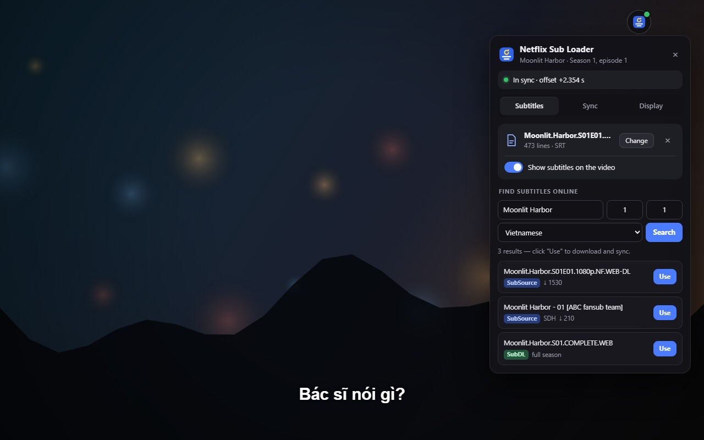
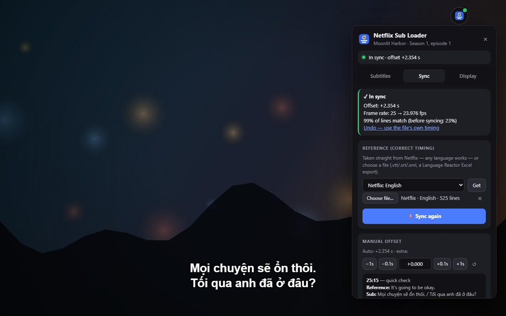
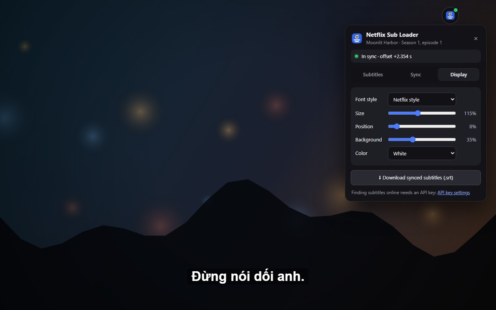

<h1 align="center">Netflix Sub Loader</h1>

Add your own subtitles to Netflix — SRT, ASS, VTT and more, in any language — synced to the video automatically.

  <a href="https://meiskwan.github.io/netflix-sub-loader/">Website</a> ·
  <a href="#install">Install</a> ·
  <a href="https://meiskwan.github.io/netflix-sub-loader/privacy-policy.html">Privacy</a> ·
  <a href="https://github.com/meIsKwan/netflix-sub-loader/issues">Support</a> ·
  <a href="https://www.paypal.com/paypalme/meiskwan">Donate</a>

Netflix Sub Loader is a free, open-source Chrome extension that adds your own subtitles to Netflix — SRT, ASS, VTT
and more, in any language — and syncs them to the video automatically. Netflix doesn't let you upload subtitle files;
Netflix Sub Loader shows them over the video right in your browser, timed to the dialogue, without you having to edit
the file.

Watch with subtitles in a language Netflix doesn't offer (such as Vietnamese), with a translation you like better,
with fan subtitles for anime, or with the subtitles you use to learn a language.

## Features

- **Custom subtitles on Netflix:** drag and drop `.srt`, `.ass`/`.ssa`, `.vtt`, `.ttml`/`.dfxp`/`.xml`, Excel
  (`.xlsx`) or `.csv`/`.tsv` files.
- **Automatic subtitle sync:** your file is compared with Netflix's own subtitle track and the delay is fixed for
  you — including frame-rate differences (25 fps vs 23.976 fps releases) and versions with scenes added or cut. If
  the file seems to be for a different episode or version, you get a warning.
- **Find subtitles without leaving Netflix:** search SubSource (home of the old Subscene archive), SubDL and
  OpenSubtitles for the exact show, season and episode you are watching, in Vietnamese, English, Japanese, Korean,
  Thai, Indonesian, Spanish or French. One click downloads and syncs; `.zip` season packs are unpacked and the right
  episode is picked for you.
- **Fine-tune by hand:** move subtitles 0.1 s earlier or later with <kbd>G</kbd> / <kbd>H</kbd> (1 s with
  <kbd>Shift</kbd>) and compare Netflix's line with yours to check the timing.
- **Jump between subtitle lines:** <kbd>A</kbd> / <kbd>D</kbd> (or <kbd>Shift</kbd>+<kbd>←</kbd> /
  <kbd>Shift</kbd>+<kbd>→</kbd>) replays the previous line or skips to the next one — handy for language learning.
- **Netflix-style look:** Netflix Sans font or a black outline, with adjustable size, position, background and
  color. Works in fullscreen.
- **Remembers every episode:** subtitles and sync are kept for the last 40 episodes, and you can export the synced
  subtitles as an `.srt` file.

| Automatic sync | Display settings |
|---|---|
|  |  |

## Install

Requires Google Chrome 111 or later.

- **Chrome Web Store:** under review — the link will appear here once it is approved.
- **From this repository (developer mode):**
  1. Click **Code → Download ZIP** above (or [download it here](https://github.com/meIsKwan/netflix-sub-loader/archive/refs/heads/main.zip)) and unzip it.
  2. Open `chrome://extensions` and turn on **Developer mode**.
  3. Click **Load unpacked** and choose the `chrome-extension` folder.
  4. Pin the Netflix Sub Loader icon in the toolbar, then open Netflix.

## How to add subtitles to Netflix

1. Open a movie or episode on Netflix.
2. Click the Netflix Sub Loader icon in the Chrome toolbar (or press <kbd>Alt</kbd>+<kbd>Shift</kbd>+<kbd>S</kbd>).
3. Drop in a subtitle file, or search online and click **Use**.
4. The subtitles appear on the video, already in sync. Change their look in the **Display** tab.

## FAQ

**How do I fix subtitles that are out of sync on Netflix?**
Load the subtitle file with Netflix Sub Loader. It uses Netflix's own subtitles as the timing reference and works out
the correct offset by itself, so there is no delay to guess. <kbd>G</kbd> / <kbd>H</kbd> nudge the timing by hand if
you want.

**Can I watch Netflix with subtitles in a language Netflix doesn't have?**
Yes. Load a subtitle file in any language and it is shown over the video. The timing reference can be in another
language, for example English.

**Which subtitle formats are supported?**
SRT, WebVTT, ASS/SSA, TTML/DFXP (XML), Excel (.xlsx) and CSV/TSV, plus .zip archives downloaded from subtitle sites.
.rar and .7z archives are not supported.

**Do I need an account to find subtitles?**
Loading your own files needs nothing. Searching online needs a free API key from SubSource, SubDL or OpenSubtitles
(one is enough), entered once in the extension's settings.

**Does it work with Language Reactor?**
Yes. A Language Reactor Excel export can be used as the timing reference, and the <kbd>A</kbd> / <kbd>D</kbd>
shortcuts don't jump twice when both extensions are installed.

**Is Netflix Sub Loader free? What data does it collect?**
It is free and open source, with no ads and no tracking. Subtitles, settings and API keys stay on your device. A
search only sends the title, season and episode to the subtitle sites you added a key for. See the
[privacy policy](https://meiskwan.github.io/netflix-sub-loader/privacy-policy.html).

## Tiếng Việt

Netflix Sub Loader giúp bạn xem Netflix với phụ đề tiếng Việt hoặc bất kỳ ngôn ngữ nào: chỉ cần thả file .srt, .ass
hoặc .vtt vào, phụ đề sẽ hiện trên video và được tự động căn khớp thời gian — không còn cảnh sub bị lệch. Tìm phụ đề
tiếng Việt trên SubSource, SubDL và OpenSubtitles ngay trong lúc xem Netflix. Miễn phí, mã nguồn mở, không quảng cáo,
không thu thập dữ liệu.

## Development

- The extension is plain JavaScript with no build step and no dependencies: [`chrome-extension/`](https://github.com/meIsKwan/netflix-sub-loader/tree/main/chrome-extension)
  (code layout and how the sync works: [`chrome-extension/README.md`](https://github.com/meIsKwan/netflix-sub-loader/blob/main/chrome-extension/README.md)).
- Tests: `cd chrome-extension && node --test` (Node 22+).
- Chrome Web Store package: `python store/make-zip.py`; submission notes are in [`store/`](https://github.com/meIsKwan/netflix-sub-loader/tree/main/store).
- The website is [`docs/`](https://github.com/meIsKwan/netflix-sub-loader/tree/main/docs), published with GitHub Pages.

Bug reports and ideas are welcome in [Issues](https://github.com/meIsKwan/netflix-sub-loader/issues).

## Support the project

Netflix Sub Loader is free. If it helps you, you can support its development on
[PayPal](https://www.paypal.com/paypalme/meiskwan).

## License

[MIT](https://github.com/meIsKwan/netflix-sub-loader/blob/main/LICENSE). The idea comes from the
[NetflixSubLoader userscript](https://github.com/AOEChamp/NetflixSubLoader) by Adeeb Mohammed; this extension is a
separate implementation and shares no code with it.

Netflix Sub Loader is an independent project and is not affiliated with, endorsed by or sponsored by Netflix,
SubSource, SubDL, OpenSubtitles or Language Reactor.
